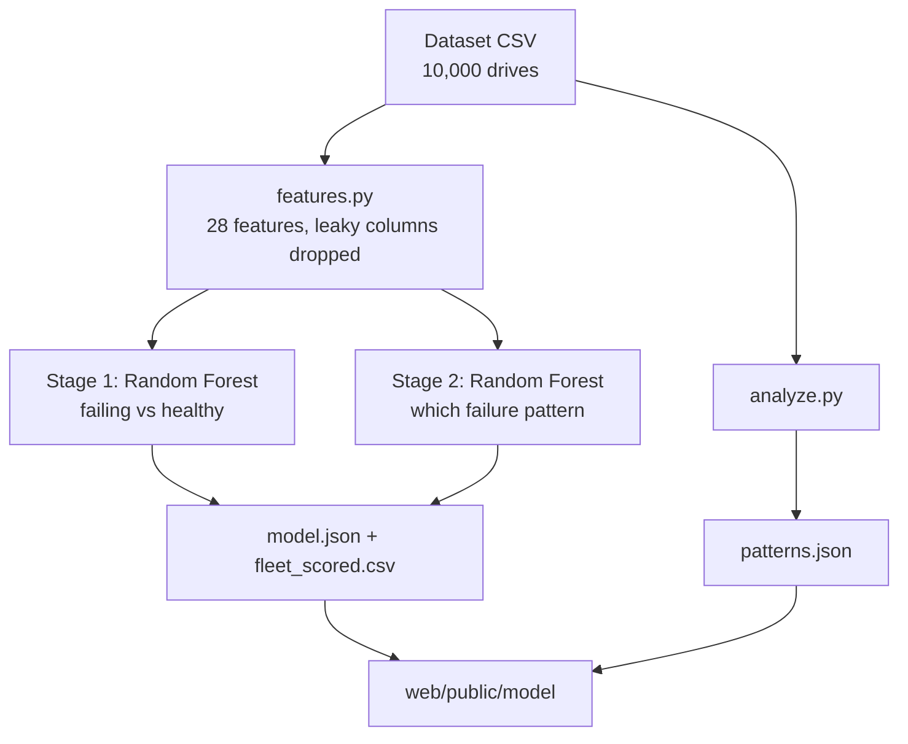
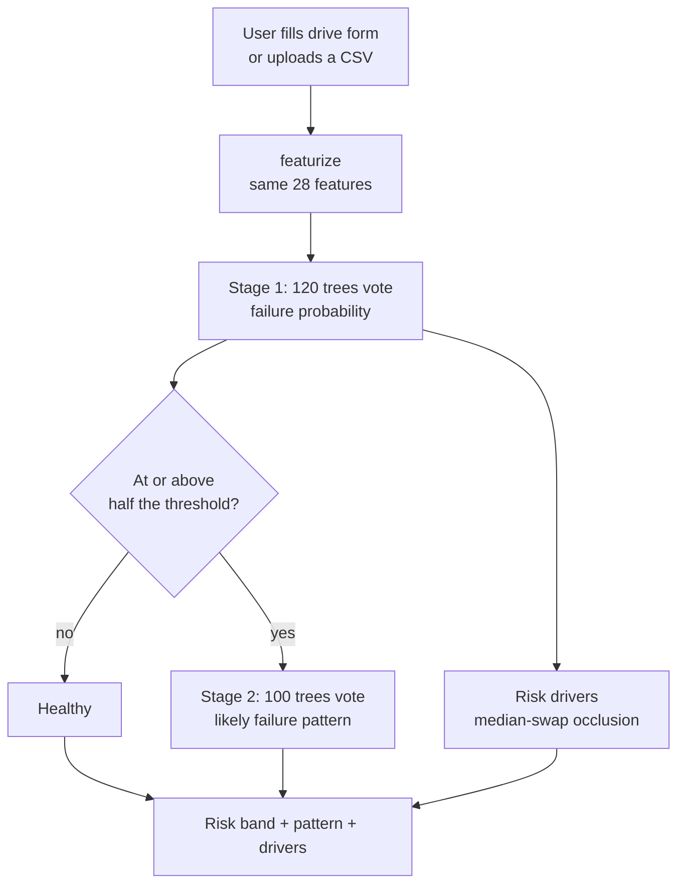

# NVMe Health Core

**Predict NVMe drive failures from SMART-style telemetry, and monitor a whole fleet from one dashboard.**

A Random Forest trained in Python is exported to JSON and runs **entirely in the browser**, so the app deploys as a single static Next.js project with no backend.


## Features

- **Drive predictor:** enter one drive's telemetry (or load a preset) and get a failure probability, a risk band, the inputs pushing the risk up, and, for at-risk drives, which failure pattern it most resembles.
- **Fleet dashboard:** band counts (Critical / High / Watch / Healthy), the 25 highest-risk drives with sortable columns and a likely-pattern column, flagged share by firmware, vendor or model, and flagged drives broken down by likely pattern.
- **Failure patterns:** the observed failure modes ranked by frequency, each with its telemetry signature versus healthy drives, failure rate by condition (hours, life used, read errors, temperature, firmware), and a correlation heatmap.
- **CSV upload:** score your own fleet. Files are processed in your browser and never uploaded anywhere.
- **No backend:** the model ships as a ~330 KB JSON file; inference is a few lines of TypeScript.
- **Honest evaluation:** leaky columns removed, imbalance handled without synthetic data, metrics reported on a held-out set.

## How it works

Two flows: training happens once offline, and everything after that runs in the browser.

**Training flow (offline, Python)**



**Prediction flow (browser, no server)**



1. `ml/train.py` fits two Random Forests and writes every tree as flat arrays (feature index, threshold, left/right child, leaf probabilities) to `web/public/model/model.json`.
2. The browser downloads that file and walks the trees, averaging leaf values. This follows scikit-learn's rule exactly: go left when `value <= threshold`.
3. **Stage 1** estimates failure probability. **Stage 2** is trained only on failing drives and answers "if this drive fails, which pattern is it?". It is shown only for at-risk drives, as a hint rather than a headline number.
4. The fleet view uses pre-computed **out-of-fold** scores, so each drive is scored by a model that never saw it.

**Why no backend?** The model is small (~400 KB), so shipping it to the browser means one static deploy, no cold starts, and uploaded data never leaves the user's machine. The tradeoff is that the model file is public. If you need a private model or scoring from other systems, put the same forests behind Flask or FastAPI, and keep a single inference path so the Python and JavaScript models cannot disagree.

## Results

Evaluated on a stratified 20% holdout (2,000 drives, 39 failures) that was never used for training or threshold selection.

| Metric | Value |
|---|---|
| Recall | **94.9%** (37 of 39 failures caught) |
| Precision | 72.5% (14 false alarms) |
| PR-AUC | 0.921 |
| ROC-AUC | 0.998 |
| Alert threshold | 0.269 |

5-fold cross-validated PR-AUC for the candidates I compared:

| Model | PR-AUC |
|---|---|
| Logistic regression | 0.30 |
| Random Forest (shipped) | 0.97 |
| Gradient boosting | 0.99 |

Random Forest was shipped because it exports cleanly to JSON for in-browser inference and the gap to gradient boosting is small. With only 39 failures in the holdout, treat these numbers as roughly ±several points.

### Failure pattern classifier (stage 2)

Trained only on the 194 failing drives, evaluated with 5-fold stratified cross-validation. `Failure_Mode` is the target here and is never an input.

| Pattern | Drives | Recall |
|---|---|---|
| Wear-out | 31 | 100% |
| Controller / firmware | 85 | 95.3% |
| Early-life | 78 | 100% |

Overall accuracy is 97.9%. These patterns are well separated in this synthetic data (life used, power-on hours, firmware), so expect lower accuracy on real fleets. Wear-out has only 31 examples, so treat its 100% as rough.

## Failure pattern analysis

The challenge brief defines five failure modes. Only three appear in the dataset, ranked here by share of the 194 failures:

| Rank | Pattern | Drives | Signature (vs healthy mean) |
|---|---|---|---|
| 1 | Controller / firmware | 85 (44%) | Media errors 3.3×, read error rate 2.1×; all on FW1.0 or FW2.0 |
| 2 | Early-life | 78 (40%) | Power-on hours ~1,600 (20× lower), read error rate 2.0×, write error rate 1.5× |
| 3 | Wear-out | 31 (16%) | Life used ~100% (4.5×) and TB written 4.5× |
| – | Thermal, power-related | 0 | Not present: the hottest drive is 67.6°C and no pattern of repeated unsafe shutdowns exists |

Relationships in the data:

- **Usage and wear** move together (TB written vs life used, r = 0.96). Risk is flat until about 80% life used, then jumps (small counts at the top end).
- **Age:** drives under 3,000 hours fail at ~17% versus ~1% for older drives.
- **Read errors:** failure rate climbs steadily once read error rate passes 10.
- **Firmware:** FW1.0 and FW2.0 fail at 3.4–3.8% versus under 1% for the others.
- **Temperature** shows no relationship with failure or with any other field (|r| ≤ 0.03). Errors also do not accumulate with age or usage, which is typical of synthetic data.

`ml/analyze.py` regenerates all of this into `web/public/model/patterns.json`, which the **Failure patterns** tab reads.

## Data and modelling choices

The dataset has 10,000 drives with 194 failures (1.94%).

- **Leakage removed.** `SMART_Warning_Flag` is identical to `Failure_Flag` on every row, and `Failure_Mode` is non-zero exactly when a drive failed. Training on either gives a meaningless ~100% score, so both are dropped.
- **28 features.** 10 raw telemetry fields, 4 engineered features (TBW, wear and media errors per 1,000 power-on hours, plus read/write ratio), and one-hot vendor, model and firmware.
- **Imbalance.** `class_weight="balanced_subsample"` instead of synthetic oversampling.
- **Threshold.** Chosen from out-of-fold predictions on the training split by maximising **F2**, which weights recall above precision because a missed failure costs more than a false alarm. The exact value is somewhat noisy given ~155 training failures.
- **Risk bands.** Critical at 50% and above, High at or above the threshold, Watch at or above half the threshold, Healthy below that.
- **Risk drivers.** Each input is swapped for the fleet median and the drop in risk is measured (occlusion). This is a quick heuristic, not SHAP. Firmware is compared against FW1.1.

## Project structure

```
nvme-health-core/
├── data/
│   └── NVMe_Drive_Failure_Dataset.csv
├── ml/
│   ├── features.py        # feature engineering (mirrored in lib/model.ts)
│   ├── train.py           # train, evaluate, export artifacts
│   └── analyze.py         # failure-pattern analysis -> patterns.json
└── web/
    ├── app/               # Next.js App Router (layout, page, Patterns tab, styles)
    ├── lib/model.ts       # featurize + forest inference + risk drivers
    └── public/model/      # model.json, fleet_scored.csv, sample_upload.csv, patterns.json
```

## Getting started

### Run the app

Requires Node.js 18.17 or newer.

```bash
cd web
npm install
npm run dev
```

Open http://localhost:3000. The trained model is already included in `web/public/model`.

### Retrain the model (optional)

```bash
pip install pandas scikit-learn
cd ml
python train.py     # model + fleet scores
python analyze.py   # failure-pattern analysis
```

These print holdout metrics and overwrite the files in `web/public/model`.

> `ml/features.py` and `web/lib/model.ts` implement the same feature engineering. If you change one, change the other.

## Using your own data

Click **Upload CSV** on the Fleet tab. A sample file is linked on that page. Required columns:

`Vendor`, `Model`, `Firmware_Version`, `Power_On_Hours`, `Total_TBW_TB`, `Total_TBR_TB`, `Temperature_C`, `Percent_Life_Used`, `Media_Errors`, `Unsafe_Shutdowns`, `CRC_Errors`, `Read_Error_Rate`, `Write_Error_Rate`

`Drive_ID` is optional. Vendor, model and firmware values should match those seen in training (`VendorA`–`VendorD`, `Model-LITE/PRO/ULTRA/X1/X2`, `FW1.0`–`FW2.1`); unknown values are treated as none-of-the-above.

## Deployment

**Vercel:** import the repository, set **Root Directory** to `web`, and deploy. No environment variables are needed.

**GitHub Pages:** set **Settings → Pages → Source** to **GitHub Actions**, build in `web` with `NEXT_PUBLIC_BASE_PATH=/<repo-name>`, and upload `web/out`. The app is a static export (`output: "export"` in `next.config.js`).

Any other static host (Netlify, Cloudflare Pages, etc.) also works: leave `NEXT_PUBLIC_BASE_PATH` unset when serving from a domain root.

## Limitations

- **Snapshot data, not history.** Each row is one reading of a drive, so the model answers "does this drive look like the ones that failed?", not "how long until it fails?". Production predictive maintenance needs repeated SMART snapshots per drive over time.
- **Small, synthetic dataset.** The challenge brief describes it as synthetic, and it shows: failure patterns are unusually clean and temperature plays no role. Expect weaker performance on real fleets.
- **Pattern classifier scope.** It can only predict the three patterns present in the data, and it assumes the drive is failing, so it is shown only for at-risk drives.
- **Three of five failure modes.** Thermal and power-related failures are documented in the brief but absent from the data, so the analysis covers only the three observed patterns.
- **The model file is public.** Browser inference means anyone can download `model.json`. If you need a private model or scoring from other systems, put the same model behind an API (Flask or FastAPI).
- **Preset drives are illustrative.** The predictor presets (Healthy, Wear-out, Firmware fault, Early-life) are example values, not rows from the dataset.

## Tech stack

Python, pandas, scikit-learn · Next.js 14 (App Router), React 18, TypeScript · plain CSS · Vercel

## License

MIT. Add a `LICENSE` file before publishing, or swap in your preferred license.
