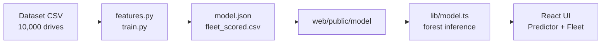

# NVMe Health Core

**Predict NVMe drive failures from SMART-style telemetry, and monitor a whole fleet from one dashboard.**

A Random Forest trained in Python is exported to JSON and runs **entirely in the browser**, so the app deploys as a single static Next.js project with no backend.


## Features

- **Drive predictor:** enter one drive's telemetry (or load a preset) and get a failure probability, a risk band, and the inputs pushing the risk up.
- **Fleet dashboard:** band counts (Critical / High / Watch / Healthy), the 25 highest-risk drives with sortable columns, and flagged share by firmware version.
- **CSV upload:** score your own fleet. Files are processed in your browser and never uploaded anywhere.
- **No backend:** the model ships as a ~330 KB JSON file; inference is a few lines of TypeScript.
- **Honest evaluation:** leaky columns removed, imbalance handled without synthetic data, metrics reported on a held-out set.

## How it works



1. `ml/train.py` fits a Random Forest and writes every tree as flat arrays (feature index, threshold, left/right child, leaf probability) to `web/public/model/model.json`.
2. The browser downloads that file and walks all 120 trees, averaging the leaf values to get a failure probability. This follows scikit-learn's rule exactly: go left when `value <= threshold`.
3. The fleet view uses pre-computed **out-of-fold** scores, so each drive is scored by a model that never saw it.

## Results

Evaluated on a stratified 20% holdout (2,000 drives, 39 failures) that was never used for training or threshold selection.

| Metric | Value |
|---|---|
| Recall | **94.9%** (37 of 39 failures caught) |
| Precision | 72.5% (14 false alarms) |
| PR-AUC | 0.921 |
| ROC-AUC | 0.998 |
| Alert threshold | 0.269 |

5-fold cross-validated PR-AUC for the candidates I compared:

| Model | PR-AUC |
|---|---|
| Logistic regression | 0.30 |
| Random Forest (shipped) | 0.97 |
| Gradient boosting | 0.99 |

Random Forest was shipped because it exports cleanly to JSON for in-browser inference and the gap to gradient boosting is small. With only 39 failures in the holdout, treat these numbers as roughly ±several points.

## Data and modelling choices

The dataset has 10,000 drives with 194 failures (1.94%).

- **Leakage removed.** `SMART_Warning_Flag` is identical to `Failure_Flag` on every row, and `Failure_Mode` is non-zero exactly when a drive failed. Training on either gives a meaningless ~100% score, so both are dropped.
- **28 features.** 10 raw telemetry fields, 4 engineered features (TBW, wear and media errors per 1,000 power-on hours, plus read/write ratio), and one-hot vendor, model and firmware.
- **Imbalance.** `class_weight="balanced_subsample"` instead of synthetic oversampling.
- **Threshold.** Chosen from out-of-fold predictions on the training split by maximising **F2**, which weights recall above precision because a missed failure costs more than a false alarm. The exact value is somewhat noisy given ~155 training failures.
- **Risk bands.** Critical at 50% and above, High at or above the threshold, Watch at or above half the threshold, Healthy below that.
- **Risk drivers.** Each input is swapped for the fleet median and the drop in risk is measured (occlusion). This is a quick heuristic, not SHAP. Firmware is compared against FW1.1.

## Project structure

```
nvme-health-core/
├── data/
│   └── NVMe_Drive_Failure_Dataset.csv
├── ml/
│   ├── features.py        # feature engineering (mirrored in lib/model.ts)
│   └── train.py           # train, evaluate, export artifacts
└── web/
    ├── app/               # Next.js App Router (layout, page, styles)
    ├── lib/model.ts       # featurize + forest inference + risk drivers
    └── public/model/      # model.json, fleet_scored.csv, sample_upload.csv
```

## Getting started

### Run the app

Requires Node.js 18.17 or newer.

```bash
cd web
npm install
npm run dev
```

Open http://localhost:3000. The trained model is already included in `web/public/model`.

### Retrain the model (optional)

```bash
pip install pandas scikit-learn
cd ml
python train.py
```

This prints holdout metrics and overwrites the files in `web/public/model`.

> `ml/features.py` and `web/lib/model.ts` implement the same feature engineering. If you change one, change the other.

## Using your own data

Click **Upload CSV** on the Fleet tab. A sample file is linked on that page. Required columns:

`Vendor`, `Model`, `Firmware_Version`, `Power_On_Hours`, `Total_TBW_TB`, `Total_TBR_TB`, `Temperature_C`, `Percent_Life_Used`, `Media_Errors`, `Unsafe_Shutdowns`, `CRC_Errors`, `Read_Error_Rate`, `Write_Error_Rate`

`Drive_ID` is optional. Vendor, model and firmware values should match those seen in training (`VendorA`–`VendorD`, `Model-LITE/PRO/ULTRA/X1/X2`, `FW1.0`–`FW2.1`); unknown values are treated as none-of-the-above.

## Limitations

- **Snapshot data, not history.** Each row is one reading of a drive, so the model answers "does this drive look like the ones that failed?", not "how long until it fails?". Production predictive maintenance needs repeated SMART snapshots per drive over time.
- **Small dataset.** Failure patterns are unusually clean, so expect weaker performance on real fleets.
- **The model file is public.** Browser inference means anyone can download `model.json`. If you need a private model or scoring from other systems, put the same model behind an API (Flask or FastAPI).
- **Preset drives are illustrative.** The predictor presets are example values, not rows from the dataset.

## Tech stack

Python, pandas, scikit-learn · Next.js 14 (App Router), React 18, TypeScript · CSS · Github pages

## License

MIT. Add a `LICENSE` file before publishing, or swap in your preferred license.
